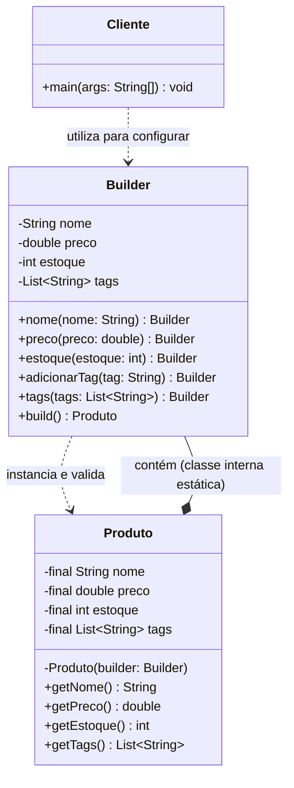

# Padrão Criacional Builder em Java: Teoria e Implementações

## 1. Teoria: O que é o Padrão Builder?

O **Builder** é um padrão de projeto criacional (*Creational Design Pattern*), catalogado originalmente pela *Gang of Four* (GoF) e popularizado no ecossistema Java por Joshua Bloch no livro *Effective Java*.

A sua proposta central é **separar a construção de um objeto complexo da sua representação final**, permitindo que o mesmo processo de construção possa criar diferentes representações de forma legível, segura e passo a passo.

---

## 2. Para que serve?

Na orientação a objetos, instanciar classes com muitos atributos (obrigatórios e opcionais) costuma gerar problemas clássicos que o Builder resolve:

* **Evita o anti-padrão *Telescoping Constructor*:** Elimina a necessidade de criar dezenas de sobrecargas de construtores com diferentes combinações de parâmetros (`new Produto(nome)`, `new Produto(nome, preco)`, `new Produto(nome, preco, estoque)`, etc.), que tornam o código difícil de ler e propenso a erros de troca de ordem entre argumentos do mesmo tipo.
* **Substitui o padrão *JavaBeans* (`setters`) em objetos imutáveis:** O uso de construtor vazio seguido de vários `setters` deixa o objeto em um estado inconsistente durante a montagem e impede que os atributos sejam `final` (imutáveis e seguros para *threads*).
* **Centraliza validações:** Permite validar regras de negócio e invariantes antes mesmo de o objeto existir na memória (dentro do método `.build()`).
* **Garante imutabilidade de coleções:** Facilita o encapsulamento defensivo de listas e conjuntos antes de entregar a instância final ao cliente.
* **Melhora a legibilidade (Interface Fluente):** O encadeamento de métodos nomeados funciona como parâmetros nomeados, deixando claro o papel de cada valor passado.

---

## 3. Onde e quando é usado?

### Cenários de Uso Recomendados

* Quando uma classe possui **4 ou mais atributos**, especialmente quando vários deles são opcionais ou possuem valores padrão.
* Quando o sistema exige **objetos imutáveis** (como DTOs, *Value Objects* no DDD, eventos de mensageria ou configurações de sistema).
* Quando a criação do objeto exige **etapas sequenciais**, manipulação de listas internas ou validações cruzadas entre campos antes da finalização.

### Exemplos Nativos na API do Java

O próprio JDK utiliza amplamente o padrão Builder em suas bibliotecas padrão:

* `java.lang.StringBuilder` e `java.lang.StringBuffer`
* `java.net.http.HttpRequest.newBuilder()`
* `java.util.stream.Stream.Builder`
* `java.util.Locale.Builder`
* `java.util.Calendar.Builder`

---

## 4. Estrutura UML (Mermaid)

O diagrama abaixo ilustra a estrutura clássica do padrão Builder aplicado ao domínio deste guia (variante *Effective Java*, onde o produto contém seu próprio builder interno):



---

## 5. Exemplos Práticos em Java

Abaixo estão **4 formas diferentes** de implementar o padrão **Builder** para a mesma classe (`Produto`), incluindo **valores padrão**, **validações** e **manipulação segura de coleções (`List<String> tags`)**.

---

### Builder1: Classe Interna Estática (Abordagem Clássica / Effective Java)

Nesta abordagem tradicional, o builder é uma classe `public static` dentro da própria classe alvo. A lista de tags recebe uma cópia defensiva imutável (`List.copyOf`) no momento da construção para impedir alterações externas posteriores.

#### 1. Definição da Classe (`Produto.java`)

```java
import java.util.ArrayList;
import java.util.Collections;
import java.util.List;

public class Produto {
    private final String nome;
    private final double preco;
    private final int estoque;
    private final List<String> tags;

    // Construtor privado: apenas o Builder1 interno tem acesso
    private Produto(Builder1 builder) {
        this.nome = builder.nome;
        this.preco = builder.preco;
        this.estoque = builder.estoque;
        // Cópia imutável defensiva da coleção
        this.tags = Collections.unmodifiableList(new ArrayList<>(builder.tags));
    }

    public String getNome() { return nome; }
    public double getPreco() { return preco; }
    public int getEstoque() { return estoque; }
    public List<String> getTags() { return tags; }

    // Classe Builder Interna Estática
    public static class Builder1 {
        private String nome;
        private double preco;
        private int estoque = 0; // Valor padrão para campo opcional
        private final List<String> tags = new ArrayList<>(); // Lista inicializada vazia por padrão

        public Builder1 nome(String nome) {
            this.nome = nome;
            return this;
        }

        public Builder1 preco(double preco) {
            this.preco = preco;
            return this;
        }

        public Builder1 estoque(int estoque) {
            this.estoque = estoque;
            return this;
        }

        // Adiciona um item individual à coleção
        public Builder1 adicionarTag(String tag) {
            if (tag != null && !tag.isBlank()) {
                this.tags.add(tag);
            }
            return this;
        }

        // Adiciona uma coleção inteira
        public Builder1 tags(List<String> tags) {
            if (tags != null) {
                this.tags.addAll(tags);
            }
            return this;
        }

        public Produto build() {
            // Validações antes de instanciar o objeto
            if (nome == null || nome.isBlank()) {
                throw new IllegalStateException("O nome do produto é obrigatório.");
            }
            if (preco < 0) {
                throw new IllegalStateException("O preço não pode ser negativo.");
            }
            return new Produto(this);
        }
    }
}

```

#### 2. Como Utilizar

```java
import java.util.List;

public class ExemploBuilder1 {
    public static void main(String[] args) {
        Produto produto = new Produto.Builder1()
                .nome("Teclado Mecânico")
                .preco(350.00)
                .adicionarTag("Periféricos")
                .adicionarTag("Gamer")
                .tags(List.of("RGB", "USB-C"))
                // 'estoque' omitido: assumirá o valor padrão 0
                .build();
    }
}

```

---

### Builder2: Classe Externa Independente

Aqui, o builder é uma classe separada em seu próprio arquivo (`Builder2.java`). Como está fora de `Produto`, a classe `Produto` expõe um construtor `public` e realiza a cópia defensiva da lista internamente.

#### 1. Definição da Classe Principal (`Produto.java`)

```java
import java.util.List;

public class Produto {
    private final String nome;
    private final double preco;
    private final int estoque;
    private final List<String> tags;

    // Construtor público necessário para o Builder externo
    public Produto(String nome, double preco, int estoque, List<String> tags) {
        this.nome = nome;
        this.preco = preco;
        this.estoque = estoque;
        this.tags = (tags == null) ? List.of() : List.copyOf(tags);
    }

    public String getNome() { return nome; }
    public double getPreco() { return preco; }
    public int getEstoque() { return estoque; }
    public List<String> getTags() { return tags; }
}

```

#### 2. Definição do Builder Externo (`Builder2.java`)

```java
import java.util.ArrayList;
import java.util.List;

public class Builder2 {
    private String nome;
    private double preco;
    private int estoque = 0; // Valor padrão para campo opcional
    private final List<String> tags = new ArrayList<>(); // Coleção padrão vazia

    public Builder2 nome(String nome) {
        this.nome = nome;
        return this;
    }

    public Builder2 preco(double preco) {
        this.preco = preco;
        return this;
    }

    public Builder2 estoque(int estoque) {
        this.estoque = estoque;
        return this;
    }

    public Builder2 adicionarTag(String tag) {
        if (tag != null && !tag.isBlank()) {
            this.tags.add(tag);
        }
        return this;
    }

    public Builder2 tags(List<String> tags) {
        if (tags != null) {
            this.tags.addAll(tags);
        }
        return this;
    }

    public Produto build() {
        // Validações centralizadas antes de chamar o construtor público
        if (nome == null || nome.isBlank()) {
            throw new IllegalStateException("O nome do produto é obrigatório.");
        }
        if (preco < 0) {
            throw new IllegalStateException("O preço não pode ser negativo.");
        }
        return new Produto(this.nome, this.preco, this.estoque, this.tags);
    }
}

```

#### 3. Como Utilizar

```java
import java.util.List;

public class ExemploBuilder2 {
    public static void main(String[] args) {
        Produto produto = new Builder2()
                .nome("Teclado Mecânico")
                .preco(350.00)
                .adicionarTag("Periféricos")
                .tags(List.of("Gamer", "RGB"))
                // 'estoque' omitido: assumirá o valor padrão 0
                .build();
    }
}

```

---

### Builder3: Classe Builder Gerada por Lombok

O **Lombok** utiliza anotações para gerar o código *boilerplate* em tempo de compilação. Para listas, a anotação `@Singular` gera automaticamente métodos para adicionar um elemento por vez (`tag(...)`), uma coleção inteira (`tags(...)`) e limpar a lista (`clearTags()`), além de entregar uma lista imutável no objeto final.

#### 1. Definição da Classe (`Produto.java`)

```java
import java.util.List;
import lombok.Builder;
import lombok.NonNull;
import lombok.Singular;
import lombok.Value;

@Value
@Builder(builderClassName = "Builder3")
public class Produto {
    @NonNull // Valida automaticamente que 'nome' não pode ser nulo (lança NullPointerException)
    String nome;

    double preco;

    @Builder.Default // Garante que o valor padrão seja respeitado pelo builder gerado
    int estoque = 0;

    @Singular("tag") // Gera .tag("...") para item único, .tags(List) para coleção e garante imutabilidade
    List<String> tags;

    // Personalização do builder gerado pelo Lombok para regras de negócio adicionais
    public static class Builder3 {
        public Produto build() {
            if (this.nome == null || this.nome.isBlank()) {
                throw new IllegalStateException("O nome do produto é obrigatório.");
            }
            if (this.preco < 0) {
                throw new IllegalStateException("O preço não pode ser negativo.");
            }
            return new Produto(this.nome, this.preco, this.estoque$value, this.tags);
        }
    }
}

```

#### 2. Como Utilizar

```java
import java.util.List;

public class ExemploLombok {
    public static void main(String[] args) {
        Produto produto = Produto.builder()
                .nome("Teclado Mecânico")
                .preco(350.00)
                .tag("Periféricos") // Método singular gerado por @Singular("tag")
                .tag("Gamer")
                .tags(List.of("RGB", "USB-C")) // Método plural gerado automaticamente
                // 'estoque' omitido: assumirá o valor padrão 0
                .build();
    }
}

```

---

### Builder4: Classe Builder Gerada por Immutables

A biblioteca **Immutables** trabalha a partir de interfaces anotadas com `@Value.Immutable`. Ela trata coleções (`List`, `Set`, `Map`) de forma nativa: gera automaticamente métodos `add...` e `addAll...`, inicializa como lista vazia se nada for informado e envolve o resultado em uma coleção estritamente imutável.

#### 1. Definição da Interface (`Produto.java`)

```java
import java.util.List;
import org.immutables.value.Value;

@Value.Immutable
@Value.Style(typeBuilder = "Builder4") // Define o nome do builder gerado como Builder4
public interface Produto {
    String nome();   // Obrigatório por padrão no Immutables
    double preco();  // Obrigatório por padrão no Immutables

    @Value.Default   // Define o valor padrão 0 caso não seja informado no builder
    default int estoque() {
        return 0;
    }

    // Coleções são nativamente suportadas: gera addTags(...) e addAllTags(...)
    // Se nenhum item for adicionado, assume lista vazia imutável por padrão
    List<String> tags();

    // Método de validação executado automaticamente ao final do .build()
    @Value.Check
    default void validar() {
        if (nome().isBlank()) {
            throw new IllegalStateException("O nome do produto é obrigatório.");
        }
        if (preco() < 0) {
            throw new IllegalStateException("O preço não pode ser negativo.");
        }
    }
}

```

#### 2. Como Utilizar

```java
import java.util.List;

public class ExemploImmutables {
    public static void main(String[] args) {
        Produto produto = ImmutableProduto.builder()
                .nome("Teclado Mecânico")
                .preco(350.00)
                .addTags("Periféricos", "Gamer") // Método gerado nativamente para itens
                .addAllTags(List.of("RGB", "USB-C")) // Método gerado nativamente para coleções
                // 'estoque' omitido: assumirá o valor padrão 0
                .build();
    }
}

```

---

## 6. Comparação Geral

| Característica | Builder1 (Interna) | Builder2 (Externa) | Builder3 (Lombok) | Builder4 (Immutables) |
| --- | --- | --- | --- | --- |
| **Encapsulamento** | Alto (construtor `private`). | Baixo (exige construtor acessível). | Alto (construtor `private` gerado). | Alto (interface + gerada). |
| **Código Boilerplate** | Alto (escrito manualmente). | Alto (escrito manualmente). | Mínimo (anotações). | Mínimo (anotações). |
| **Campos Obrigatórios** | Validação manual no `.build()`. | Validação manual no `.build()`. | Manual ou via `@NonNull`. | **Nativo** (lança exceção se faltar). |
| **Valores Padrão** | Atribuição direta no campo do builder. | Atribuição direta no campo do builder. | Requer `@Builder.Default`. | Requer `@Value.Default` no método. |
| **Coleções / Listas** | Manual (`add`/`addAll` + `unmodifiableList`). | Manual (`add`/`addAll` + `List.copyOf`). | Via `@Singular` (singular, plural e lista imutável). | **Nativo** (gera `add`, `addAll` e lista imutável). |
| **Validação de Regras** | Manual dentro do `.build()`. | Manual dentro do `.build()`. | Sobrescrevendo o `.build()` interno. | Via método anotado com `@Value.Check`. |
| **Dependências** | Nenhuma (Java puro). | Nenhuma (Java puro). | Biblioteca Lombok + Plugin IDE. | Biblioteca Immutables (Annotation Processor). |

---

## 7. Geração Automatizada de Builders no VS Code

Escrever todo o código *boilerplate* de um Builder manual (`Builder1` ou `Builder2`) linha por linha pode ser repetitivo. No **Visual Studio Code (VS Code)**, você pode agilizar ou automatizar essa criação combinando recursos nativos de reescrita com extensões especializadas.

### 7.1. Ferramentas e Extensões Úteis no Marketplace

* **Design Patterns Snippets for Java**: Extensão prática focada em injetar códigos de padrões GoF. Ela permite que você gere esqueletos de construtores e builders rapidamente por meio de comandos.
* **Extension Pack for Java (Red Hat)**: Fornece as *Source Actions* essenciais do ecossistema Java no VS Code (`Ctrl+.` no Windows/Linux ou `Cmd+.` no macOS, ou clique com o botão direito -> **Source Action...**). Embora não crie um Builder completo com um único clique nativo, ela agiliza a criação de **Construtores parametrizados**, **Getters** e **Setters** que servem de alicerce para estruturar classes complexas.
* **Suporte ao Lombok via Maven/Gradle**: Caso utilize a abordagem do **Builder3**, certifique-se de habilitar o processamento de anotações (*Annotation Processing*) no seu projeto Java no VS Code para que o plugin do Lombok gere os métodos fluentes automaticamente em segundo plano.

### 7.2. Como aplicar via Comandos e Atalhos

1. Abra o arquivo `.java` contendo os atributos da sua classe (ex: `Produto.java`).
2. Utilize o atalho da Paleta de Comandos (`Ctrl+Shift+P` ou `Cmd+Shift+P`).
3. Busque por comandos providos por extensões de produtividade/design patterns (como comandos de geração de código para construtores ou templates do Builder).
4. Caso prefira o método sem plugins de terceiros, utilize as *Source Actions* (`Ctrl+.`) para gerar rapidamente o construtor privado e os getters da classe principal, escrevendo a estática interna do Builder com o auxílio do *IntelliSense* do VS Code.
